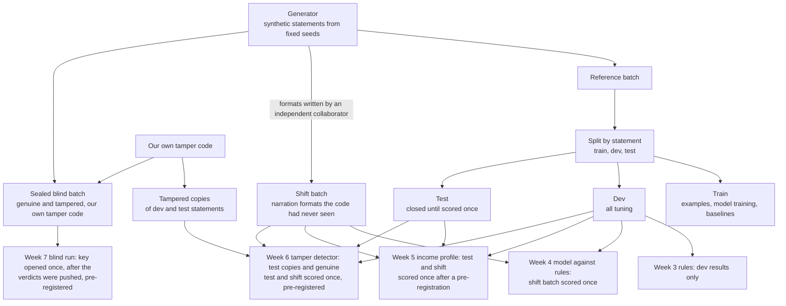

# StatementScreen

[](https://github.com/manasvinipujaiyer/statement-screen/actions/workflows/ci.yml)

StatementScreen takes one Indian bank-statement PDF and returns an estimated income profile
(salary, employer, estimated monthly income, EMIs, bounces, rent, each finding with a
plain-language reason) and a tamper verdict: no evidence of tampering, suspicious, tampered,
or could not check. It reads the PDF with pdfplumber, finds recurring patterns with
explainable rules, and checks arithmetic, file structure, layout and an IsolationForest
anomaly score. It uses classical ML and rules, no LLMs. Everything used to build it and every
result below is synthetic, made by this project's own generator, and no real statement has
been evaluated.

> **All data in this repo is synthetic.** If real statements are evaluated later, that will
> be private: they will stay on my laptop and never be published.
>
> The banks, IFSC-style codes, UPI handles, employers and merchants in the synthetic data
> are fictional, and every generated PDF carries a "SYNTHETIC DOCUMENT" footer.

## Results at a glance

These tables are generated from the committed reports by `scripts/results_tables.py`, and a
test fails if they differ from `reports/`. Each is labelled dev, one-time test, shift or
blind. Dev was used for tuning, so dev numbers are in-sample.

<!-- results:start -->
<!-- Generated by scripts/results_tables.py from reports/. Do not edit. -->

**Tamper detection, sealed blind run (blind: scored once, key opened after the verdicts were pushed).** Source: [`reports/week7_blind_report.json`](reports/week7_blind_report.json). Intervals are the report's bootstrap intervals.

| Result | Count (rate) [interval] |
|---|---|
| Tampered PDFs called tampered | 104/121 (85.95%) [79.34%, 92.56%] |
| Tampered PDFs called tampered or suspicious | 106/121 (87.60%) [80.99%, 93.39%] |
| Precision of tampered (called tampered, and was tampered) | 104/104 (100.00%) |
| Genuine PDFs called tampered | 0/79 (0.00%) |
| Genuine PDFs called tampered or suspicious | 0/79 (0.00%) |

Blind run by tamper type. Source: [`reports/week7_blind_report.json`](reports/week7_blind_report.json).

| Tamper type | n | Tampered | Tampered or suspicious |
|---|---|---|---|
| rerender_inconsistent | 17 | 17/17 (100.00%) | 17/17 (100.00%) |
| inplace_edit | 21 | 21/21 (100.00%) | 21/21 (100.00%) |
| page_swap | 28 | 28/28 (100.00%) | 28/28 (100.00%) |
| page_remove | 11 | 11/11 (100.00%) | 11/11 (100.00%) |
| overlay | 15 | 15/15 (100.00%) | 15/15 (100.00%) |
| inplace_edit_consistent | 13 | 12/13 (92.31%) | 12/13 (92.31%) |
| rerender_consistent | 16 | 0/16 (0.00%) | 2/16 (12.50%) |

A type where every PDF was caught has a zero-width bootstrap interval, narrower than the real uncertainty (see docs/blind_test.md).

**Tamper detection, Week 6 test (one-time test: scored once, copies of the test split).** Source: [`reports/week6_tamper_test.json`](reports/week6_tamper_test.json). Intervals are the report's bootstrap intervals.

| Group | n | Tampered | Tampered or suspicious [interval] |
|---|---|---|---|
| rerender_inconsistent | 100 | 100/100 (100.00%) | 100/100 (100.00%) [100.00%, 100.00%] |
| rerender_consistent | 100 | 0/100 (0.00%) | 14/100 (14.00%) [8.00%, 21.00%] |
| inplace_edit | 100 | 100/100 (100.00%) | 100/100 (100.00%) [100.00%, 100.00%] |
| inplace_edit_consistent | 100 | 97/100 (97.00%) | 97/100 (97.00%) [93.00%, 100.00%] |
| page_swap | 100 | 100/100 (100.00%) | 100/100 (100.00%) [100.00%, 100.00%] |
| page_remove | 100 | 100/100 (100.00%) | 100/100 (100.00%) [100.00%, 100.00%] |
| overlay (held out) | 100 | 100/100 (100.00%) | 100/100 (100.00%) [100.00%, 100.00%] |
| genuine test | 300 | 0/300 (0.00%) | 7/300 (2.33%) [0.99%, 4.33%] |
| genuine shift | 300 | 0/300 (0.00%) | 5/300 (1.67%) [0.33%, 3.33%] |
| resaved genuine | 100 | 0/100 (0.00%) | 2/100 (2.00%) [0.00%, 5.00%] |

An interval of zero width (every item was correct) is narrower than the real uncertainty.

**Income profile (dev, one-time test and shift).** Source: [`reports/week5_test_and_shift.json`](reports/week5_test_and_shift.json). Intervals are the report's bootstrap intervals.

| Metric | Dev (used for tuning) | Test (scored once) | Shift (scored once) |
|---|---|---|---|
| Statements | 300 | 300 | 300 |
| Income within 5% | 94.00% [91.33%, 96.67%] | 94.00% [91.00%, 96.67%] | 93.00% [90.00%, 95.67%] |
| Income within 10% | 99.00% [97.99%, 100.00%] | 97.00% [95.00%, 98.67%] | 98.33% [96.67%, 99.67%] |
| Employer exact match | 95.68% [92.44%, 98.40%] | 95.14% [91.93%, 98.01%] | 61.08% [53.80%, 68.26%] |
| Employer fuzzy match | 97.84% [95.35%, 99.48%] | 97.30% [94.87%, 99.44%] | 66.49% [59.03%, 72.97%] |
| has_salary precision | 100.00% [100.00%, 100.00%] | 100.00% [100.00%, 100.00%] | 100.00% [100.00%, 100.00%] |
| has_salary recall | 100.00% [100.00%, 100.00%] | 100.00% [100.00%, 100.00%] | 100.00% [100.00%, 100.00%] |
| Customer-type accuracy | 100.00% [100.00%, 100.00%] | 100.00% [100.00%, 100.00%] | 100.00% [100.00%, 100.00%] |
| EMI count exact | 100.00% [100.00%, 100.00%] | 100.00% [100.00%, 100.00%] | 100.00% [100.00%, 100.00%] |
| Bounce count exact | 100.00% [100.00%, 100.00%] | 100.00% [100.00%, 100.00%] | 77.33% [72.66%, 82.00%] |

Dev was used for tuning, so the dev column is in-sample and not a held-out estimate. An interval of zero width (every item was correct) is narrower than the real uncertainty.

**Rules against the Week 4 model, F1 (dev, and the shift batch scored once).** Source: [`reports/week4_classifier.json`](reports/week4_classifier.json). Dev was used for tuning. The shift batch uses narration formats written by an independent collaborator who had not seen the code.

| F1 | Dev: rules | Dev: model | Shift: rules | Shift: model | Shift: model minus rules [interval] |
|---|---|---|---|---|---|
| is_salary | 0.9988 | 0.9994 | 0.9991 | 0.3890 | -0.6101 [-0.6836, -0.5440] |
| is_emi | 1.0000 | 1.0000 | 1.0000 | 1.0000 | 0.0000 [0.0000, 0.0000] |
| is_bounce | 1.0000 | 0.9205 | n/a | 0.3731 | n/a [+0.2970, +0.4587] |
| is_rent | 0.9981 | 1.0000 | 0.9959 | 0.9956 | -0.0002 [-0.0007, 0.0000] |
| has_salary | 1.0000 | 1.0000 | 1.0000 | 0.4079 | -0.5921 [-0.6593, -0.5279] |

n/a: the rules flag no bounce row on the shift batch, so their F1 is undefined in the first, one-time scoring, and the interval shown for that row is the report's, computed with their F1 taken as 0; the post-hoc re-run is described in docs/classifier_vs_rules.md.

**Parser (the whole reference batch, and the shift batch).** Sources: [`reports/week2_parse_report.json`](reports/week2_parse_report.json) and [`reports/week4_shift_parse_report.json`](reports/week4_shift_parse_report.json). Clean, text-based PDFs from this project's own renderer.

| Parser | Reference batch | Shift batch |
|---|---|---|
| Statements | 2,000 | 300 |
| Rows parsed exactly (date, amount, balance) | 1,177,258/1,177,258 | 177,841/177,841 |
| Exact-row rate | 100.00% | 100.00% |
| Layout detected correctly | 2,000/2,000 | 300/300 |
| Narrations wrong | 0 | 0 |
| Narrations cut short by the layout (share of all narrations) | 8.74% | 3.02% |

What these show, and what they do not:

- On the sealed blind run the frozen detector called 104 of 121 tampered PDFs tampered (precision 104 of 104) and called 0 of 79 genuine PDFs tampered or suspicious.
- A tampered copy with correct arithmetic is mostly missed:0 of 16 such PDFs were called tampered on the blind run, and 0 of 100 in the Week 6 test.
- On the shift batch, where the narration formats were unseen, the income profile matched the employer exactly for 61.08% of the salaried statements (test: 95.14%) and got the bounce count exactly right for 77.33% of the statements (test: 100.00%).
- On those unseen formats the model's is_salary F1 was 0.3890, against 0.9991 for the rules; the model had learned that a NEFT credit means salary (see docs/classifier_vs_rules.md).
- All of these results are on synthetic statements from this project's own generator, and no real statement has been evaluated.

<!-- results:end -->

## How it works

Each box is a stage with its own page under `docs/`.

```mermaid
flowchart LR
    pdf["Statement PDF"] --> parser["Parser<br/>layout detection, money as integer paise"]
    parser --> checks["Self-checks<br/>balance chain, summary totals, dates"]
    parser --> clean["Cleaning<br/>channel, direction, counterparty"]
    clean --> group["Grouping<br/>fuzzy match and character n-grams"]
    group --> rules["Rules<br/>salary, EMI, bounce, rent,<br/>each with a plain reason"]
    rules --> profile["Income profile<br/>income, employer, EMIs, bounces, warnings"]
    pdf --> tamper["Tamper checks<br/>arithmetic, structure, file history,<br/>layout and font, anomaly score"]
    checks -->|"arithmetic findings"| tamper
    profile -.->|"two anomaly features"| tamper
    tamper --> verdict["Verdict<br/>no evidence, suspicious,<br/>tampered or could not check"]
    profile --> service["Service: POST /screen<br/>one PDF at a time"]
    verdict --> service
    service --> response["JSON response<br/>profile, verdict, timing, code version"]
    service --> audit["SQLite audit log<br/>one row per request, no statement text,<br/>fails closed"]
```



- [Parsing](docs/parsing.md): layout detection, money as integer paise, named self-checks.
- [Pattern detection](docs/patterns.md): cleaning, grouping and rules, each flag with a reason.
- [Income profile](docs/income_profile.md): what "monthly income" means and how it is built.
- [Tamper detection](docs/tamper_detection.md): the checks, the verdict rules, the test.
- [The service](docs/service.md) and its [audit log](docs/service.md#the-audit-log).

## Quick start

Requires [uv](https://docs.astral.sh/uv/).

```bash
uv sync                                   # create .venv and install dependencies
uv run pytest                             # tests
uv run ruff check . && uv run ruff format --check .

# 50 synthetic statements, checked from the written files alone
uv run python -m statementscreen.generate --n 50 --seed 42 --out data/synthetic/
uv run python -m statementscreen.verify data/synthetic/
```

Screen one PDF locally (there is no authentication; the service is for local use only):

```bash
uv run python -m statementscreen.service          # http://127.0.0.1:8000
curl -F "file=@data/synthetic/pdfs/stmt_0001.pdf;type=application/pdf" \
  http://127.0.0.1:8000/screen
```

Or in Docker with Colima (no Docker Desktop):

```bash
colima start --cpu 2 --memory 2
COMMIT="$(git rev-parse HEAD)$([ -n "$(git status --porcelain)" ] && echo +dirty)"
docker build -t statementscreen:w7 \
  --build-arg UV_VERSION="$(uv --version | cut -d' ' -f2)" \
  --build-arg GIT_COMMIT="$COMMIT" .
docker volume create statementscreen-audit
docker run -d --name statementscreen -p 127.0.0.1:8000:8000 \
  -v statementscreen-audit:/audit statementscreen:w7
```

[docs/service.md](docs/service.md) has the response format, what the audit log keeps and
never keeps, the limits, and the speed and image size.

## How it was evaluated

Which data each result used. Dev was used for tuning, so dev results are in-sample.



- **Splits are locked.** The reference batch is split by statement into train, dev and test.
  A loader refuses a manifest whose hash does not match, and the test split is refused unless
  `STATEMENTSCREEN_OPEN_TEST=1` is set.
- **One-time scoring.** A held-out set is scored once, after everything is frozen. Where a
  later re-run was made it is labelled post-hoc.
- **Pre-registration.** For the income profile, the tamper detector and the blind run, the
  frozen commit, hashes, commands and expectations were written to a file in `reports/`,
  committed and pushed before the held-out data was scored. One disclosed exception: the
  blind run's detector started before the review of its pre-registration finished (see
  [the blind-test disclosure](docs/limits.md#the-blind-test)).
- **The shift batch** uses narration formats written by an independent collaborator who had
  not seen the code, to test what the rules and the model do on formats they were not built
  on.
- **The blind run.** 200 PDFs, genuine and tampered with this project's own tamper code,
  were sealed with an answer key. The frozen Week 6 detector ran without the key, the
  verdicts were committed and pushed, and only then was the key opened and published.

Stage by stage, with the report behind each: [docs/evaluation_protocol.md](docs/evaluation_protocol.md).
The blind run in full: [docs/blind_test.md](docs/blind_test.md).

## Most important limits

The full list, with every figure, and its report where one exists, is [docs/limits.md](docs/limits.md). The ones
to read first:

1. **Everything is synthetic, from our own generator.** How far the results carry over to real
   statements has not been measured ([data](docs/limits.md#data-and-the-generator)).
2. **Every tampered PDF comes from our own tamper code.** No outside person edited a PDF, so
   the rates say nothing about real forgeries ([tamper detection](docs/limits.md#tamper-detection)).
3. **A tampered copy with correct arithmetic is mostly missed.** Re-rendered copies with consistent
   totals were not called tampered in the Week 6 test or the blind run, and only the anomaly
   score ever flagged any of them ([tamper detection](docs/limits.md#tamper-detection)).
4. **Dev was used for tuning,** so dev results are in-sample, and dev overstated one
   pre-registered metric on test ([evaluation](docs/limits.md#evaluation)).
5. **The Week 4 model learned a shortcut** (a NEFT credit means salary) and collapsed on
   unseen narration formats; the rules held up on salary but failed on bounces and employer
   names ([evaluation](docs/limits.md#evaluation)).
6. **The Week 7 detector ran under the first version of its pre-registration,** which was
   regenerated after review. The detector fingerprint is the same in both and the run was not
   repeated ([the blind test](docs/limits.md#the-blind-test)).
7. **The seal proves the key was not changed, not that nobody read it** ([the blind
   test](docs/limits.md#the-blind-test)).
8. **Week 5 erratum.** Its report text wrongly said the test split and shift batch were
   unseen before scoring: the shift batch was scored in Week 4 and the test statements were
   opened in Week 5 ([evaluation](docs/limits.md#evaluation)).
9. **Real statements have not been evaluated** (next section).
10. **The service has no authentication and is for local use only;** it handles one PDF at a
    time ([the service](docs/limits.md#the-service)).

## Real statements: not yet evaluated

Every result here is on synthetic statements from this project's own generator. The gap
between synthetic and real statements is unmeasured, and the layouts, narration styles and
edge cases of real banks may differ from anything the generator produces. Real statements are
never committed or published, and no figure computed from them is in this repository.

The planned evaluation, not yet done: a small set of consented real statements, kept off the project and off any cloud service, scored privately with aggregate
metrics only: parse rate by bank, hand-labelled salary, employer and EMIs, and income error.
There are no dates and no expected numbers.

## Reproduce everything

From a fresh clone:

```bash
git clone https://github.com/manasvinipujaiyer/statement-screen.git && cd statement-screen
uv sync --locked
```

Several commands write their report into `reports/`, replacing the committed file. Work in a
fresh clone and use `git diff reports/` to see whether your run reproduced it.

| Stage | Exact commands | Cost, from the report | One-time? |
|---|---|---|---|
| Reference batch (seed 42), verify | [data generation](docs/data_generation.md) | 133 s, 129 MB ([`week1_run_summary.json`](reports/week1_run_summary.json)) | No |
| Parse and score | [parsing](docs/parsing.md) | 1,738.5 s ([`week2_parse_report.json`](reports/week2_parse_report.json)) | No |
| Split | `splits/split_v1.*` are committed; [patterns](docs/patterns.md) | none | Locked: loaders check the manifest hash |
| Patterns and dev scoring | [patterns](docs/patterns.md) | 4.4 s for dev ([`week3_patterns_dev.json`](reports/week3_patterns_dev.json)) | No |
| Shift batch, features, training, comparison | [classifier vs rules](docs/classifier_vs_rules.md) | training 154.1 s ([`week4_training.json`](reports/week4_training.json)) | The comparison refuses a second shift scoring |
| Income profile on dev | [income profile](docs/income_profile.md) | none | No |
| Profile on test and shift | the `commands` list in [`week5_preregistration.json`](reports/week5_preregistration.json) | none | Yes: pre-registered; a re-run is not a first result |
| Tamper copies and detection | the `commands` list in [`week6_preregistration.json`](reports/week6_preregistration.json) | 1,076.9 s genuine test, 1,066.7 s genuine shift ([`week6_tamper_test.json`](reports/week6_tamper_test.json)) | Yes: pre-registered; a re-run is not a first result |
| Blind run | the `commands` list in [`week7_blind_preregistration.json`](reports/week7_blind_preregistration.json) | none | Yes: the scoring opened the key once and now refuses to run (see [the blind test](docs/blind_test.md)) |
| Service | [the service](docs/service.md) | see that page | No |

**Rebuild the blind set from the published key.** The two source batches were generated from
seeds 7101 (default narrations) and 7102 (`karan_v1`), from `main_seed` in
[`reports/week7_blind_preregistration.json`](reports/week7_blind_preregistration.json),
100 statements each (from `splits/eval_blind_*.json`). The generation flags below are inferred from those, not recorded
in one place; `blind_verify` checks every regenerated source against the key's hashes, so it
fails if they are wrong.

```bash
uv run python -m statementscreen.generate --n 100 --seed 7101 --out data/blind_src/default_v1
uv run python -m statementscreen.generate --n 100 --seed 7102 --narration-dialect karan_v1 \
    --out data/blind_src/karan_v1
uv run python -m statementscreen.tamper.blind_verify --key reports/week7_blind_key.json \
    --verdicts reports/week7_blind_verdicts.csv --blind-src data/blind_src
```

It exits 0 when every PDF is rebuilt byte for byte. Its saved output is in
[`reports/week7_blind_verify.txt`](reports/week7_blind_verify.txt).

**Rebuild the README tables:** `uv run python scripts/results_tables.py` prints them;
`--write` rewrites the generated block in "Results at a glance".

## Repository layout

```
src/statementscreen/   the package
  synth/               generator, renderer, narration dialects
  parsing/             PDF parser and its self-checks
  patterns/            narration cleaning, grouping and rules
  profile/             the income profile
  tamper/              tamper generator, detector and the blind-test tools
  service/             FastAPI service and SQLite audit log
scripts/               helpers: anomaly model, layout and font measurement, latency, results tables
tests/                 pytest suite (no test needs data/, so CI can run it)
reports/               committed results: the source of the generated tables
splits/                locked train/dev/test split and the registered shift and blind batches
docs/                  the detailed write-ups
models/                the IsolationForest model the tamper detector uses
data/, mlruns/         generated data and MLflow runs (git-ignored)
Dockerfile, pyproject.toml, uv.lock
```

## Documentation

- [Generating synthetic statements](docs/data_generation.md)
- [Parsing](docs/parsing.md)
- [Pattern detection](docs/patterns.md)
- [Classifier vs rules](docs/classifier_vs_rules.md)
- [Income profile](docs/income_profile.md)
- [Tamper detection](docs/tamper_detection.md)
- [The service](docs/service.md)
- [The blind tamper test](docs/blind_test.md)
- [Evaluation protocol](docs/evaluation_protocol.md)
- [Limits, errata and disclosures](docs/limits.md)

## Licences

Dependencies that are not MIT, BSD or Apache (certifi, matplotlib and typing-extensions) are
listed with their licences in [docs/limits.md](docs/limits.md) (E14), together with the notes
on LightGBM's OpenMP runtime and the service's dependencies. All are used unmodified.

## License

MIT. See [LICENSE](LICENSE).
